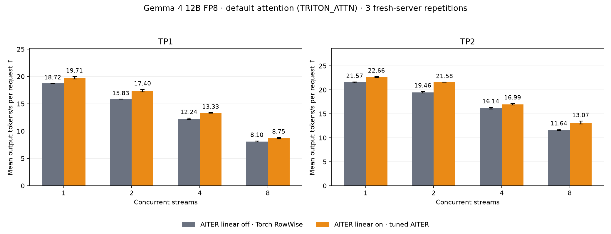
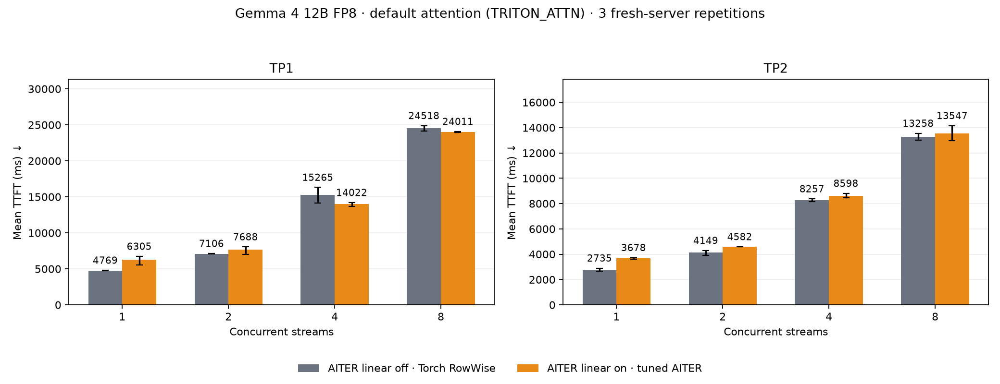
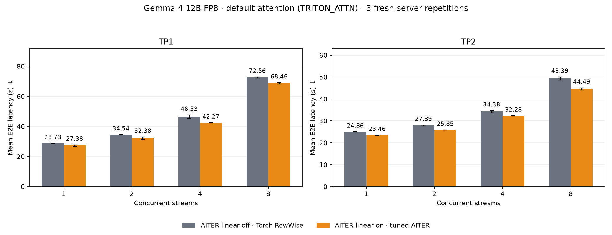

# AITER linear off/on: TP1 and TP2 with default attention (TRITON_ATTN)

Model `RedHatAI/gemma-4-12B-it-FP8-Dynamic`, observed model/tokenizer main commit `2083adceb2a3df0465e6021e08a7196d21dbbb44`. Two Radeon AI PRO R9700 gfx1201 GPUs, Torch 2.13.0+rocm10, HIP 7.15.26333, Triton 3.8. TP1 uses GPU0; TP2 uses GPUs 0/1. Source base `6c0ee98741189ecc468b931335abfbc3a5b594ac` plus the preserved local patch (SHA256 `dd5850d9537803e95c4f1511e1431d0206bb05244b652c8b489fd8c9efc3d6f0`). Frozen copies preserve both vLLM and installed AITER source/configs; hashes and original commands are retained in the [manifest](provenance/manifest.json).

Both arms leave attention, prefix caching, and model/tokenizer revisions at their defaults, load the full model, and use `--linear-backend auto` with `VLLM_ROCM_USE_AITER=1`. There is no language-model-only flag or attention-specific environment override. The unpinned model main commit is checked before and after every case; the client tokenizer uses that matching cached snapshot. Only `VLLM_ROCM_USE_AITER_LINEAR` changes (0 → 1), besides fresh cache paths and output destinations. Server logs verify Gemma 4 defaults to TRITON_ATTN and enables prefix caching in every case, Torch RowWise when linear is off, and unshuffled AITER per-token FP8 when on. Tuned AITER configs come from the installed package, corresponding to the companion [ROCm/aiter#6245](https://github.com/ROCm/aiter/pull/6245).

Workload: eight-turn simple-agent conversations, 2048 new synthetic prompt tokens and exactly 512 generated output tokens per turn, streams 1/2/4/8, seed 20260715, one configured warmup request. 3 fresh-server repetitions per TP/arm; alternating TP and arm order; unique empty compile caches. BF16, FP8 KV cache, prefix caching, max model length 32768, max batched tokens 8192, max sequences 8, GPU utilization 0.90. Client uses a single asynchronous worker with pending buffer 2.0. Every profile must reach its configured peak and at least 98% mean concurrency; every conversation contains all eight turns. All accepted profiles have 8/16/32/64 successful records, zero errors/incomplete requests.

Metrics use every successful request including warmup/cooldown. TPS is per request. Bars show pooled means; error bars show min/max independent run means. Higher TPS and lower TTFT/E2E improve performance. Geomeans weight the four concurrency levels equally. Full prompts grow from ~2k to ~20k tokens; response retokenization creates modest history differences (maximum matched mean prompt-length delta 0.317%). Fresh-cache first-use compilation costs remain included in these end-to-end serving metrics. Historical results using explicit unified attention and language-only loading are not mixed into this comparison.

## Reproduction

Use GuideLLM 0.7.3. Each raw case includes its exact server command and environment in `setup.json`; see the [baseline setup](../../../../results/gfx1201/gemma-4-12b-fp8-dynamic/rocm10-aiter-linear-default-attn-tp1-tp2-20261011-v1/tp1-linear-off-rep1/setup.json) and [recorded client workload](../../../../results/gfx1201/gemma-4-12b-fp8-dynamic/rocm10-aiter-linear-default-attn-tp1-tp2-20261011-v1/tp1-linear-off-rep1/workload.json). Copy the workload locally and adjust its backend target, tokenizer snapshot path, and output path for your environment, retaining the other settings. The measured client invocation was:

```bash
GUIDELLM__MAX_WORKER_PROCESSES=1 \
GUIDELLM__MP_MAX_PENDING_BUFFER_PERCENT=2.0 \
guidellm run --config workload.json
```

Run each TP/arm separately with a fresh server and empty compile caches. Change `VLLM_ROCM_USE_AITER_LINEAR` from 0 to 1 for the candidate, keeping the master AITER flag enabled in both arms. The manifest records the three-repetition order. Check the unpinned server's resolved model commit against the recorded commit and use the matching client tokenizer.

## Results

| TP | TPS geomean, on/off | E2E geomean, on/off | Paired-run TPS GM range |
|---:|---:|---:|---:|
| 1 | 1.080x (+8.0%) | 0.935x (-6.5%) | 1.075–1.085x |
| 2 | 1.083x (+8.3%) | 0.927x (-7.3%) | 1.069–1.101x |

## TP1

| Streams | Output tok/s, baseline → candidate | Output tok/s change | Mean TTFT (ms), baseline → candidate | Mean TTFT (ms) change | Mean E2E (s), baseline → candidate | Mean E2E (s) change |
|---:|---:|---:|---:|---:|---:|---:|
| 1 | 18.72 → 19.71 | **+5.3%** | 4,769 → 6,305 | +32.2% | 28.73 → 27.38 | **−4.7%** |
| 2 | 15.83 → 17.40 | **+9.9%** | 7,106 → 7,688 | +8.2% | 34.54 → 32.38 | **−6.3%** |
| 4 | 12.24 → 13.33 | **+9.0%** | 15,265 → 14,022 | **−8.1%** | 46.53 → 42.27 | **−9.2%** |
| 8 | 8.10 → 8.75 | **+7.9%** | 24,518 → 24,011 | **−2.1%** | 72.56 → 68.46 | **−5.6%** |

[Per-turn TPS/TTFT/E2E charts](tp1-linear-on-vs-off/report.md).

## TP2

| Streams | Output tok/s, baseline → candidate | Output tok/s change | Mean TTFT (ms), baseline → candidate | Mean TTFT (ms) change | Mean E2E (s), baseline → candidate | Mean E2E (s) change |
|---:|---:|---:|---:|---:|---:|---:|
| 1 | 21.57 → 22.66 | **+5.1%** | 2,735 → 3,678 | +34.5% | 24.86 → 23.46 | **−5.6%** |
| 2 | 19.46 → 21.58 | **+10.9%** | 4,149 → 4,582 | +10.4% | 27.89 → 25.85 | **−7.3%** |
| 4 | 16.14 → 16.99 | **+5.2%** | 8,257 → 8,598 | +4.1% | 34.38 → 32.28 | **−6.1%** |
| 8 | 11.64 → 13.07 | **+12.3%** | 13,258 → 13,547 | +2.2% | 49.39 → 44.49 | **−9.9%** |

[Per-turn TPS/TTFT/E2E charts](tp2-linear-on-vs-off/report.md).

## Achieved concurrency

| TP | Streams | Mean active, off | Mean active, on | Peak in every run |
|---:|---:|---:|---:|---:|
| 1 | 1 | 1.000 | 1.000 | 1 |
| 1 | 2 | 2.000 | 2.000 | 2 |
| 1 | 4 | 3.999 | 3.999 | 4 |
| 1 | 8 | 7.999 | 7.999 | 8 |
| 2 | 1 | 1.000 | 1.000 | 1 |
| 2 | 2 | 1.999 | 1.999 | 2 |
| 2 | 4 | 3.999 | 3.999 | 4 |
| 2 | 8 | 7.998 | 7.998 | 8 |







These measurements compare serving performance for this model/workload/hardware. Numerical/model accuracy and multimodal validation remain separate work; successful synthetic-text requests do not establish accuracy equivalence. All repetitions are retained, with no performance-based run selection. Raw accepted reports and source/config hashes are linked below.

- [tp1-linear-off-rep1](../../../../results/gfx1201/gemma-4-12b-fp8-dynamic/rocm10-aiter-linear-default-attn-tp1-tp2-20261011-v1/tp1-linear-off-rep1/agent-multiturn-benchmarks.json) · SHA256 `9ba7ddf907f29b0bc4ae7285b09af40aca2a6807b6a261a6038bac7a978d8e65`
- [tp1-linear-off-rep2](../../../../results/gfx1201/gemma-4-12b-fp8-dynamic/rocm10-aiter-linear-default-attn-tp1-tp2-20261011-v1/tp1-linear-off-rep2/agent-multiturn-benchmarks.json) · SHA256 `a937c76634992310b0a066a54ef0badc9e85a29ceba9be5dae8e92e590c86632`
- [tp1-linear-off-rep3](../../../../results/gfx1201/gemma-4-12b-fp8-dynamic/rocm10-aiter-linear-default-attn-tp1-tp2-20261011-v1/tp1-linear-off-rep3/agent-multiturn-benchmarks.json) · SHA256 `3663977d16d01e2b4ba98e394d953419280b57d62aa3e47e034323769f6fdf0b`
- [tp1-linear-on-rep1](../../../../results/gfx1201/gemma-4-12b-fp8-dynamic/rocm10-aiter-linear-default-attn-tp1-tp2-20261011-v1/tp1-linear-on-rep1/agent-multiturn-benchmarks.json) · SHA256 `6c7b82fdfc6b1c1f403628a3637d68ed2e7acb42c27cc0a603a494a906101ccf`
- [tp1-linear-on-rep2](../../../../results/gfx1201/gemma-4-12b-fp8-dynamic/rocm10-aiter-linear-default-attn-tp1-tp2-20261011-v1/tp1-linear-on-rep2/agent-multiturn-benchmarks.json) · SHA256 `ccfdfeffc951e433de21fde04140fdd7f2a9cc90c981ff86a0023ec6c7c60b49`
- [tp1-linear-on-rep3](../../../../results/gfx1201/gemma-4-12b-fp8-dynamic/rocm10-aiter-linear-default-attn-tp1-tp2-20261011-v1/tp1-linear-on-rep3/agent-multiturn-benchmarks.json) · SHA256 `259679dc2f80eca5c626bc4992eed31ea4efe34474113b7d6e295d52d01bb499`
- [tp2-linear-off-rep1](../../../../results/gfx1201/gemma-4-12b-fp8-dynamic/rocm10-aiter-linear-default-attn-tp1-tp2-20261011-v1/tp2-linear-off-rep1/agent-multiturn-benchmarks.json) · SHA256 `d726929ff260bb2f6104c84dac4498008d4b2c2585f949d8dfc7059d3061045e`
- [tp2-linear-off-rep2](../../../../results/gfx1201/gemma-4-12b-fp8-dynamic/rocm10-aiter-linear-default-attn-tp1-tp2-20261011-v1/tp2-linear-off-rep2/agent-multiturn-benchmarks.json) · SHA256 `e10dbe2c544549991c74dca7eea244ce6608d6fa839481944f3199562d203239`
- [tp2-linear-off-rep3](../../../../results/gfx1201/gemma-4-12b-fp8-dynamic/rocm10-aiter-linear-default-attn-tp1-tp2-20261011-v1/tp2-linear-off-rep3/agent-multiturn-benchmarks.json) · SHA256 `8eaa1d79a0117ccbf8cf0bece17704b5e2166d1de192923fc8b3d9ae34b2cd05`
- [tp2-linear-on-rep1](../../../../results/gfx1201/gemma-4-12b-fp8-dynamic/rocm10-aiter-linear-default-attn-tp1-tp2-20261011-v1/tp2-linear-on-rep1/agent-multiturn-benchmarks.json) · SHA256 `650f2814055a4eb337d661030b7f9932b0b2e7cbeac526964eebd8ced45274c7`
- [tp2-linear-on-rep2](../../../../results/gfx1201/gemma-4-12b-fp8-dynamic/rocm10-aiter-linear-default-attn-tp1-tp2-20261011-v1/tp2-linear-on-rep2/agent-multiturn-benchmarks.json) · SHA256 `3b162545f464b23a20163d0addc99729618371e40529173deaec76b5c5f283a5`
- [tp2-linear-on-rep3](../../../../results/gfx1201/gemma-4-12b-fp8-dynamic/rocm10-aiter-linear-default-attn-tp1-tp2-20261011-v1/tp2-linear-on-rep3/agent-multiturn-benchmarks.json) · SHA256 `a76d0209953d6d9fa0e686701627e4e25f77d14cff6d79316c1fd566f5ef8f8b`
