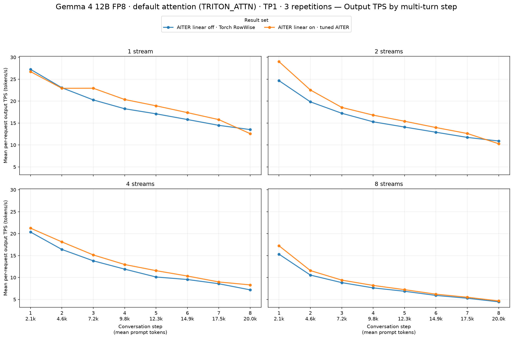
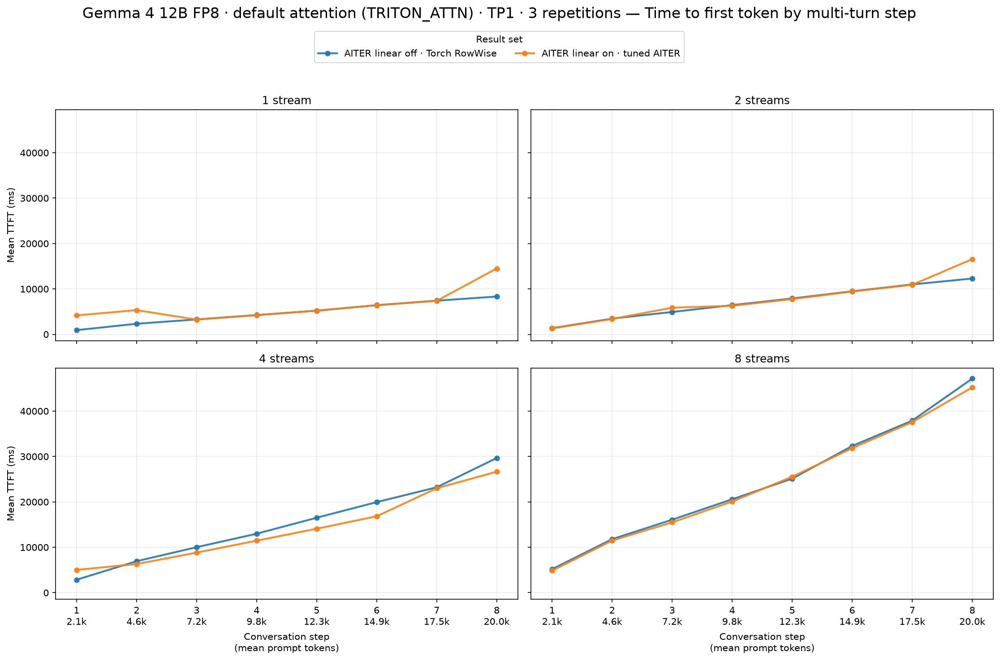
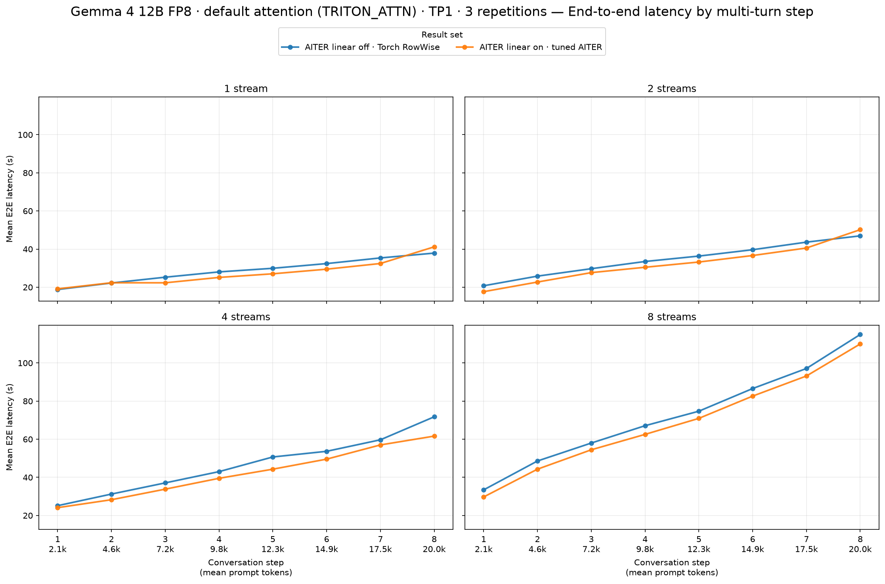

# TP1: AITER linear off → on

See [full setup](../report.md). All successful requests are included. Positive TPS and negative TTFT/E2E changes improve performance.

| Streams | Output tok/s, baseline → candidate | Output tok/s change | Mean TTFT (ms), baseline → candidate | Mean TTFT (ms) change | Mean E2E (s), baseline → candidate | Mean E2E (s) change |
|---:|---:|---:|---:|---:|---:|---:|
| 1 | 18.72 → 19.71 | **+5.3%** | 4,769 → 6,305 | +32.2% | 28.73 → 27.38 | **−4.7%** |
| 2 | 15.83 → 17.40 | **+9.9%** | 7,106 → 7,688 | +8.2% | 34.54 → 32.38 | **−6.3%** |
| 4 | 12.24 → 13.33 | **+9.0%** | 15,265 → 14,022 | **−8.1%** | 46.53 → 42.27 | **−9.2%** |
| 8 | 8.10 → 8.75 | **+7.9%** | 24,518 → 24,011 | **−2.1%** | 72.56 → 68.46 | **−5.6%** |

