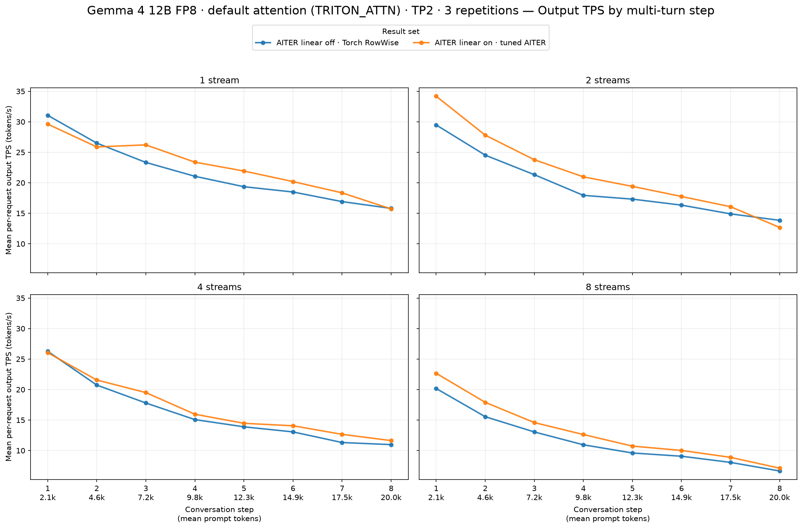
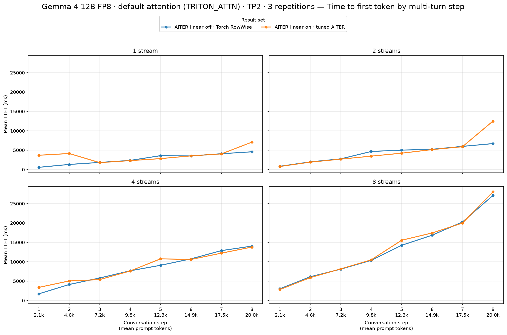
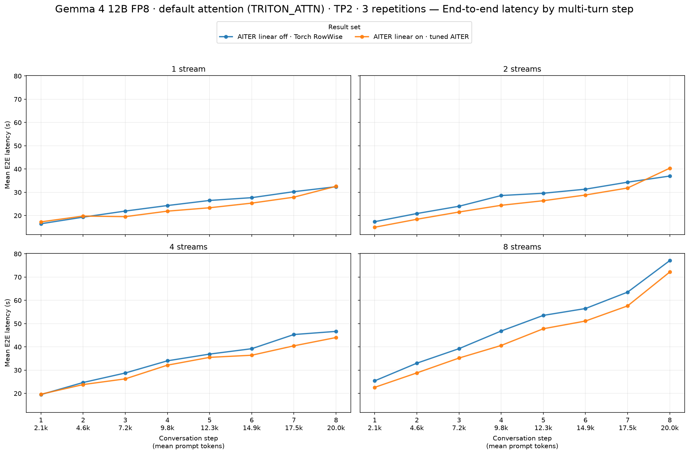

# TP2: AITER linear off → on

See [full setup](../report.md). All successful requests are included. Positive TPS and negative TTFT/E2E changes improve performance.

| Streams | Output tok/s, baseline → candidate | Output tok/s change | Mean TTFT (ms), baseline → candidate | Mean TTFT (ms) change | Mean E2E (s), baseline → candidate | Mean E2E (s) change |
|---:|---:|---:|---:|---:|---:|---:|
| 1 | 21.57 → 22.66 | **+5.1%** | 2,735 → 3,678 | +34.5% | 24.86 → 23.46 | **−5.6%** |
| 2 | 19.46 → 21.58 | **+10.9%** | 4,149 → 4,582 | +10.4% | 27.89 → 25.85 | **−7.3%** |
| 4 | 16.14 → 16.99 | **+5.2%** | 8,257 → 8,598 | +4.1% | 34.38 → 32.28 | **−6.1%** |
| 8 | 11.64 → 13.07 | **+12.3%** | 13,258 → 13,547 | +2.2% | 49.39 → 44.49 | **−9.9%** |

