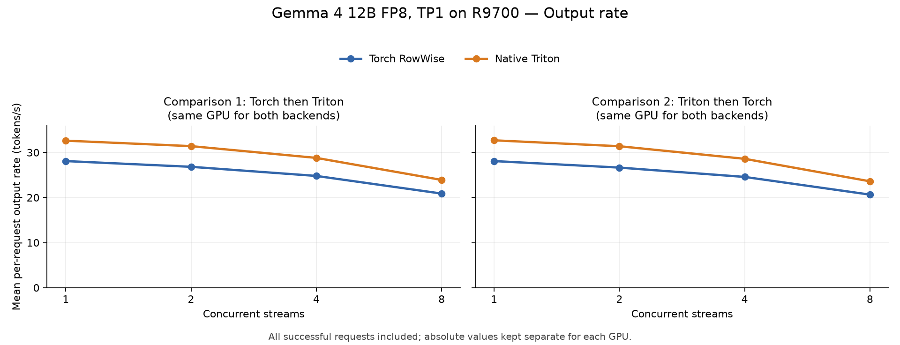
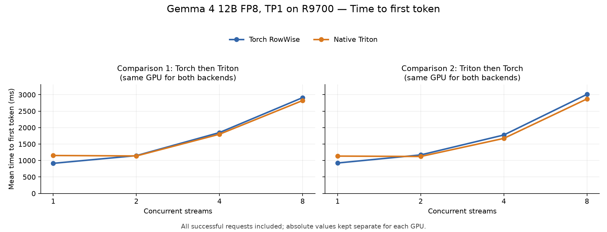
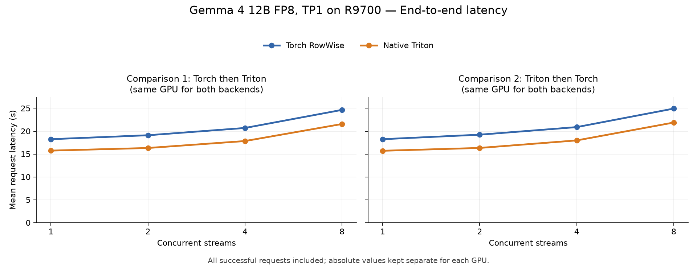
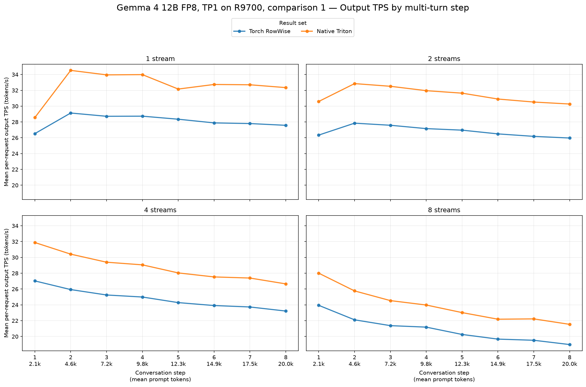
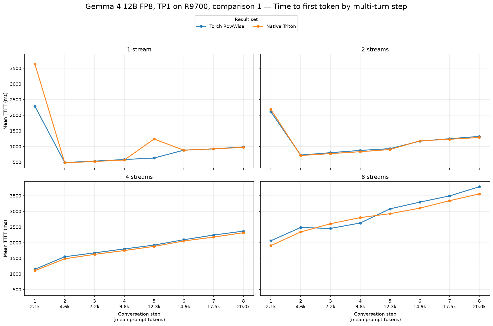
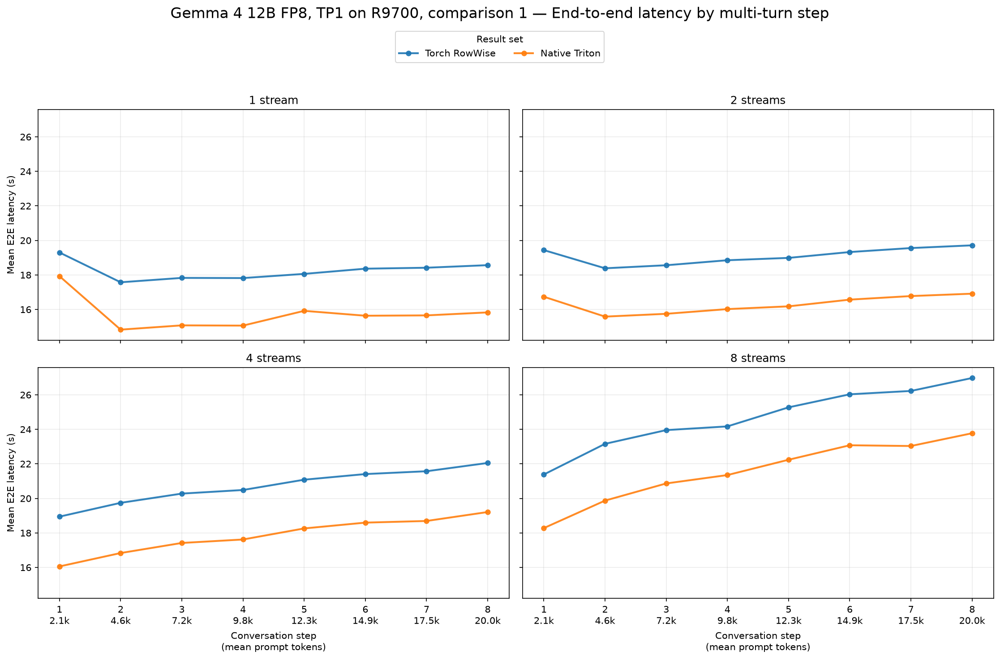
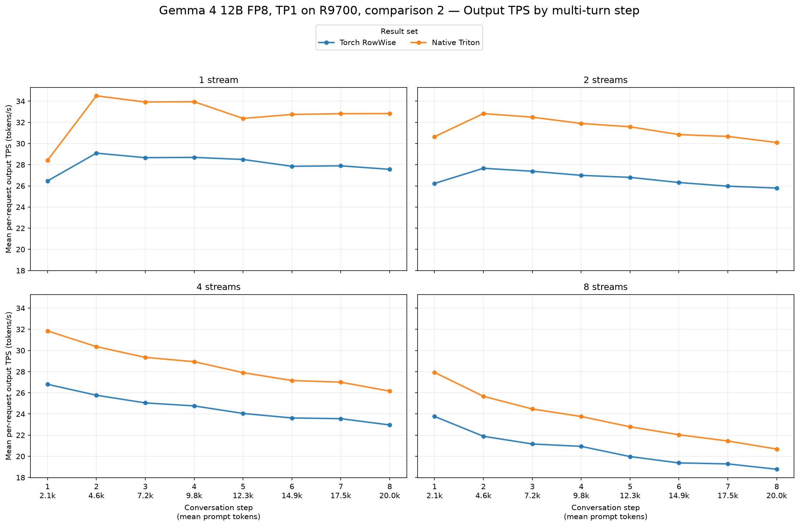
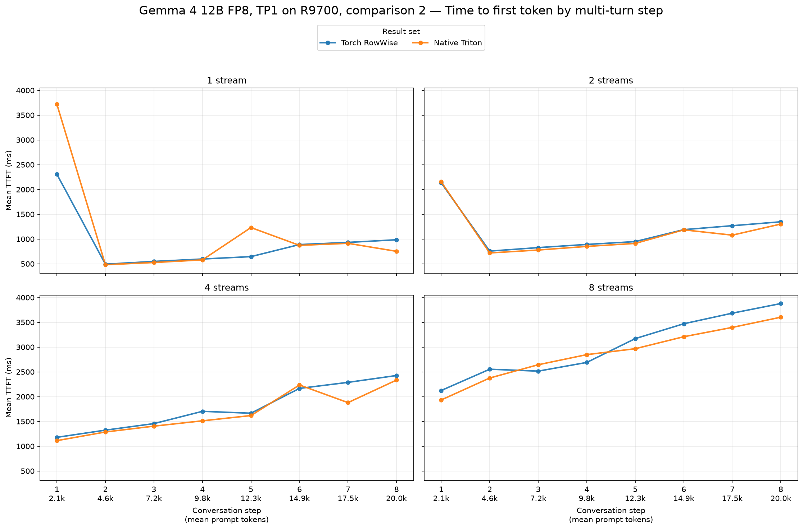
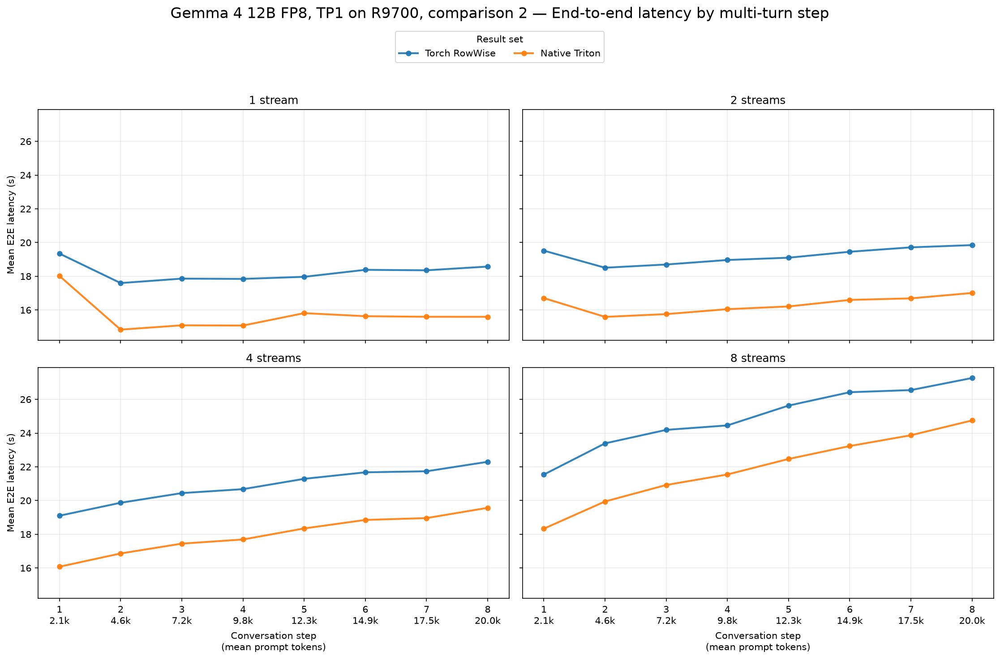

# Native Triton per-token FP8 versus Torch RowWise

Fresh TP1 serving comparisons for [vLLM PR #61091](https://github.com/vllm-project/vllm/pull/61091).

Measured vLLM commit: [`678e155d2b7f`](https://github.com/big-yellow-duck/vllm/commit/678e155d2b7f1a63702dbed1025879ddd5a88bcc).

## Setup

Radeon AI PRO R9700 (gfx1201), Torch 2.13 with ROCm 10, Triton 3.8, GuideLLM 0.7.3. Model: `RedHatAI/gemma-4-12B-it-FP8-Dynamic`. Both backends use ROCM_AITER_UNIFIED_ATTN, FP8 KV cache, BF16 output, default compilation/graphs and prefix caching. AITER linear is disabled. Only `--linear-backend torch` versus `--linear-backend triton` changes.

Two independent comparisons use two cards. Each baseline/candidate pair runs sequentially on the same physical GPU: pair 1 is Torch then Triton; pair 2 is Triton then Torch. Every configuration starts a fresh server with empty compilation caches. The first greeting smoke request is outside the benchmark; every successful benchmark request, including first-use specialization and configured warmup/cooldown requests, is included below. Server startup and graph capture are outside the request measurements.

## Compatibility and completeness

All four reports use the same model ID, tokenizer ID, synthetic workload and seed (20260715). Each profile has 8 turns, 2048 configured prompt tokens per turn, and exactly 512 output tokens per request. Streams 1/2/4/8 finish 8/16/32/64 requests respectively and attain the configured peak concurrency. All 480 requests succeed, with zero errors or incomplete requests. Server logs confirm the intended linear kernel, six tuning files for Triton, and completed graph capture. Tracked vLLM sources and benchmark runner hashes remain unchanged.

Actual prompts include chat templates and prior conversation history. The x-axis shows mean observed prompt tokens. The largest within-pair difference in mean prompt length is 0.19%; generated history can differ between backends.

## Paired results

The table shows the geometric mean of the two within-GPU candidate/baseline ratios. The TPS range shows the two observed percentage changes, not a confidence interval. Absolute latencies and token rates are kept separate for each card. Positive output TPS changes and negative TTFT/E2E changes are improvements (bold). Output TPS is mean per-request end-to-end output tokens/s, including time to first token; it is not aggregate server throughput or a GEMM-only measurement.

| Streams | Output tok/s change | TPS change range | Mean TTFT change | Mean E2E change |
|---:|---:|---:|---:|---:|
| 1 | **+16.3%** | +16.1% to +16.4% | +24.4% | **−13.8%** |
| 2 | **+17.4%** | +17.1% to +17.8% | **−2.5%** | **−14.8%** |
| 4 | **+16.3%** | +16.1% to +16.4% | **−4.3%** | **−13.9%** |
| 8 | **+14.4%** | +14.3% to +14.5% | **−3.8%** | **−12.4%** |







## Pair 1: same-GPU absolute results

| Streams | Output tok/s, baseline → candidate | Output tok/s change | Mean TTFT (ms), baseline → candidate | Mean TTFT (ms) change | Mean E2E (s), baseline → candidate | Mean E2E (s) change |
|---:|---:|---:|---:|---:|---:|---:|
| 1 | 28.09 → 32.62 | **+16.1%** | 915 → 1,153 | +26.0% | 18.24 → 15.74 | **−13.7%** |
| 2 | 26.82 → 31.41 | **+17.1%** | 1,149 → 1,139 | **−0.9%** | 19.10 → 16.32 | **−14.6%** |
| 4 | 24.79 → 28.80 | **+16.1%** | 1,850 → 1,800 | **−2.7%** | 20.70 → 17.84 | **−13.8%** |
| 8 | 20.88 → 23.91 | **+14.5%** | 2,911 → 2,823 | **−3.0%** | 24.65 → 21.56 | **−12.5%** |







## Pair 2: same-GPU absolute results

| Streams | Output tok/s, baseline → candidate | Output tok/s change | Mean TTFT (ms), baseline → candidate | Mean TTFT (ms) change | Mean E2E (s), baseline → candidate | Mean E2E (s) change |
|---:|---:|---:|---:|---:|---:|---:|
| 1 | 28.09 → 32.70 | **+16.4%** | 925 → 1,135 | +22.7% | 18.24 → 15.71 | **−13.9%** |
| 2 | 26.64 → 31.38 | **+17.8%** | 1,171 → 1,123 | **−4.1%** | 19.23 → 16.33 | **−15.1%** |
| 4 | 24.57 → 28.59 | **+16.4%** | 1,776 → 1,673 | **−5.8%** | 20.88 → 17.97 | **−13.9%** |
| 8 | 20.65 → 23.60 | **+14.3%** | 3,011 → 2,872 | **−4.6%** | 24.93 → 21.88 | **−12.2%** |







## Interpretation and limits

Native Triton raises the paired mean per-request output rate by 14.4–17.4% across the four stream levels. Both independent comparisons improve at every stream level. Mean E2E latency is lower at all four levels. Single-stream mean TTFT increases by 24.4%, with increases at turns 1 and 5 visible in both comparisons; mean TTFT falls at 2/4/8 streams. These turn-level costs are retained in the means and charts.

See both per-pair tables and the per-turn charts when assessing repeatability. Two matched pairs are a small sample, and these results cover one model, TP1 and gfx1201. They do not establish performance on other hardware or model task accuracy. Fresh caches retain first-use effects; a TTFT regression must be read alongside output rate and total request latency rather than removed by excluding early requests.

## Reproduce

| Comparison | Torch RowWise report | Native Triton report |
|---|---|---|
| 1 | [JSON](../../../../results/gfx1201/gemma-4-12b-fp8-dynamic/rocm10-native-triton-pr61091-tp1-20261012-v1/tp1-rowwise-rep1/agent-multiturn-benchmarks.json) | [JSON](../../../../results/gfx1201/gemma-4-12b-fp8-dynamic/rocm10-native-triton-pr61091-tp1-20261012-v1/tp1-triton-tuned-rep1/agent-multiturn-benchmarks.json) |
| 2 | [JSON](../../../../results/gfx1201/gemma-4-12b-fp8-dynamic/rocm10-native-triton-pr61091-tp1-20261012-v1/tp1-rowwise-rep2/agent-multiturn-benchmarks.json) | [JSON](../../../../results/gfx1201/gemma-4-12b-fp8-dynamic/rocm10-native-triton-pr61091-tp1-20261012-v1/tp1-triton-tuned-rep2/agent-multiturn-benchmarks.json) |

Use the direct `vllm serve` commands in the PR, running the two configurations separately on the same GPU. Start each with an empty compilation cache. Then run:

```bash
GUIDELLM__MP_MAX_PENDING_BUFFER_PERCENT=2.0 \
GUIDELLM__MAX_WORKER_PROCESSES=1 \
guidellm run --config workload.json
```

The portable [workload](workload.json) targets `http://localhost:8000` and uses the model ID for tokenization. Neither serving command uses model or tokenizer revision arguments; the resolved default model revision is recorded in the [provenance](../../../../results/gfx1201/gemma-4-12b-fp8-dynamic/rocm10-native-triton-pr61091-tp1-20261012-v1/provenance.json).

Raw JSON reports and per-case provenance are under `results/gfx1201/gemma-4-12b-fp8-dynamic/rocm10-native-triton-pr61091-tp1-20261012-v1`. Regenerate the charts with `scripts/plot_compare_multiturn.py` and the absolute result tables with `scripts/summarize_guidellm.py`, using the RowWise report as baseline. Run `analyze.py --repo <benchmark-repository>` to revalidate reports and regenerate the paired table. [summary.json](summary.json) contains the numeric source, completeness checks and prompt lengths.
