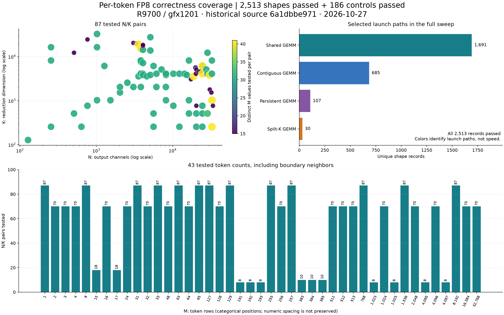
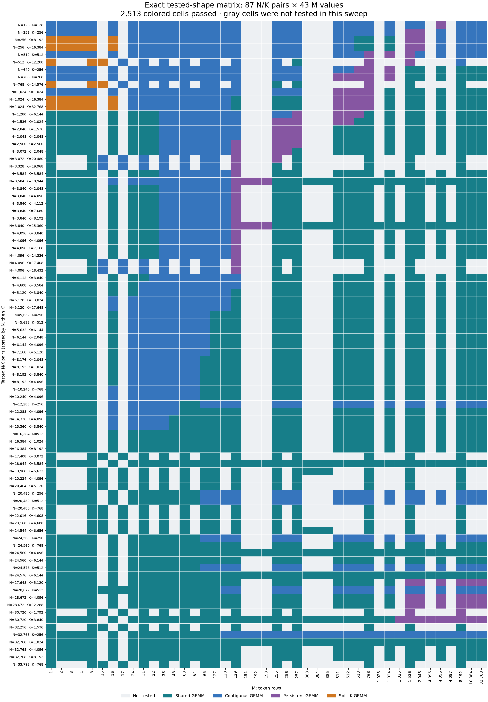

# Per-token FP8: broad shape correctness on gfx1201

Historical validation on 2026-10-27 passed **2,513 distinct M/N/K shapes** and
**186 additional controls**. This bundle makes that evidence inspectable for
[vLLM PR #61091](https://github.com/vllm-project/vllm/pull/61091), particularly
[the shape-coverage review comment](https://github.com/vllm-project/vllm/pull/61091#discussion_r4494706183).

The records were collected against
[`6a1dbbe97195eccd06fbcb45d47b485ea6b6ecd1`](https://github.com/big-yellow-duck/vllm/commit/6a1dbbe97195eccd06fbcb45d47b485ea6b6ecd1).
The archived backend, launcher, selection rules, and pytest source match the
SHA-256 hashes recorded at measurement time. This is **historical correctness
evidence**, not a rerun of the current PR tip, a guarantee for every shape or
architecture, or a new performance/accuracy claim.

## Coverage at a glance



[Download overview: SVG](coverage-overview.svg). Charts count saved correctness records; they do not show latency or numerical error magnitudes.

### Validation results

| Check group | Shapes / configurations | Output / bias | Reference and check | Passed | Failed |
| --- | --- | --- | --- | ---: | ---: |
| Full-output sweep | 2,513 unique M/N/K shapes; 87 N/K pairs | BF16; no bias; untuned selector | Every output vs Torch RowWise; finite outputs; up to 16 × 32 sampled FP32 values | 2,513 | 0 |
| Dtype / bias / scale layout | 11 shapes × 2 dtypes × 2 bias settings × 4 layouts | BF16 / FP16; bias off / on | Sampled FP32 reference and finite outputs, repeated three times | 176 | 0 |
| Compiled dynamic shapes | Two configurations; M changes through one compiled callable | BF16; tuning maps absent / present | Sampled FP32; full output vs eager execution | 2 | 0 |
| Graph replay | Eight launch cases; three replays with mutated inputs / scales | BF16; selected and explicit launches | Sampled FP32; full output vs shared Triton implementation | 8 | 0 |

All comparison tolerances are `rtol=atol=1e-2`. The raw records report pass/fail, not maximum or mean numerical error; no error magnitudes are inferred. FP8 E4M3FN operands use FP32 per-token/per-channel scales. Inputs are seeded per shape.

### Shape ranges

| Dimension | Meaning | Distinct values | Minimum | Maximum |
| --- | --- | ---: | ---: | ---: |
| M | Token rows | 43 | 1 | 32,768 |
| N | Output channels | 45 | 128 | 33,792 |
| K | Reduction dimension | 35 | 128 | 32,768 |

The ranges are bounds of observed values, not exhaustive Cartesian coverage. The full sweep is BF16 without bias; the other dtypes and layouts are separate controls.

### Input corpora and overlap

| Corpus | Recorded cases | New unique shapes in this table order | Overlap with earlier rows |
| --- | ---: | ---: | ---: |
| [Broad synthetic / model-derived](validation-broad.jsonl) | 2,170 | 2,170 | 0 |
| [Additional synthetic](validation-blind.jsonl) | 150 | 137 | 13 |
| [Boundary neighbors](validation-boundaries.jsonl) | 150 | 86 | 64 |
| [Prospective set 2](validation-prospective2.jsonl) | 120 | 120 | 0 |
| **Total** | **2,590** | **2,513** | **77** |

Overlap is counted relative to preceding rows, not as independent pairwise overlaps. Some corpora informed selector refinement, so this is regression coverage rather than an untouched final holdout.

### Launch paths exercised

| Selected launch path | Unique shapes | Share of full sweep | Passed | Failed |
| --- | ---: | ---: | ---: | ---: |
| Shared GEMM | 1,691 | 67.3% | 1,691 | 0 |
| Contiguous GEMM | 685 | 27.3% | 685 | 0 |
| Persistent GEMM | 107 | 4.3% | 107 | 0 |
| Split-K GEMM | 30 | 1.2% | 30 | 0 |

Paths are derived from each record's saved configuration. Split-K includes 18 shapes using four splits and 12 using eight; persistent covers 107 shapes. These are correctness counts, not speedups.

### Exact coverage matrix

Each colored cell is one tested, passing `(M, N, K)` combination. Gray means not tested in this sweep. The matrix has 3,741 possible displayed cells; 2,513 were tested. This fraction describes only this displayed grid, not all possible shapes.

<details>
<summary>Expand the full 87-pair × 43-token-count matrix</summary>



[Open full-resolution PNG](shape-matrix.png) · [Download SVG](shape-matrix.svg)

</details>

### Results for every N/K pair

[Download pair summary](coverage-by-pair.csv) · [Download every shape result](shape-results.csv). The pair CSV includes the exact tested M values; min/max do not imply intervening values were tested.

<details>
<summary>Expand all 87 N/K pairs</summary>

| N | K | Tested M values | Min M | Max M | Passed | Failed |
| ---: | ---: | ---: | ---: | ---: | ---: | ---: |
| 128 | 128 | 31 | 1 | 32,768 | 31 | 0 |
| 256 | 256 | 31 | 1 | 32,768 | 31 | 0 |
| 256 | 8,192 | 31 | 1 | 32,768 | 31 | 0 |
| 256 | 16,384 | 31 | 1 | 32,768 | 31 | 0 |
| 512 | 512 | 31 | 1 | 32,768 | 31 | 0 |
| 512 | 12,288 | 15 | 1 | 8,192 | 15 | 0 |
| 640 | 256 | 31 | 1 | 32,768 | 31 | 0 |
| 768 | 768 | 31 | 1 | 32,768 | 31 | 0 |
| 768 | 24,576 | 15 | 1 | 8,192 | 15 | 0 |
| 1,024 | 1,024 | 31 | 1 | 32,768 | 31 | 0 |
| 1,024 | 16,384 | 31 | 1 | 32,768 | 31 | 0 |
| 1,024 | 32,768 | 31 | 1 | 32,768 | 31 | 0 |
| 1,280 | 6,144 | 31 | 1 | 32,768 | 31 | 0 |
| 1,536 | 1,024 | 31 | 1 | 32,768 | 31 | 0 |
| 2,048 | 1,536 | 31 | 1 | 32,768 | 31 | 0 |
| 2,048 | 2,048 | 31 | 1 | 32,768 | 31 | 0 |
| 2,560 | 2,560 | 31 | 1 | 32,768 | 31 | 0 |
| 3,072 | 2,048 | 31 | 1 | 32,768 | 31 | 0 |
| 3,072 | 20,480 | 15 | 1 | 8,192 | 15 | 0 |
| 3,328 | 19,968 | 15 | 1 | 8,192 | 15 | 0 |
| 3,584 | 3,584 | 31 | 1 | 32,768 | 31 | 0 |
| 3,584 | 18,944 | 41 | 1 | 32,768 | 41 | 0 |
| 3,840 | 2,048 | 31 | 1 | 32,768 | 31 | 0 |
| 3,840 | 4,096 | 31 | 1 | 32,768 | 31 | 0 |
| 3,840 | 4,112 | 31 | 1 | 32,768 | 31 | 0 |
| 3,840 | 7,680 | 31 | 1 | 32,768 | 31 | 0 |
| 3,840 | 8,192 | 31 | 1 | 32,768 | 31 | 0 |
| 3,840 | 15,360 | 41 | 1 | 32,768 | 41 | 0 |
| 4,096 | 3,840 | 31 | 1 | 32,768 | 31 | 0 |
| 4,096 | 4,096 | 31 | 1 | 32,768 | 31 | 0 |
| 4,096 | 7,168 | 31 | 1 | 32,768 | 31 | 0 |
| 4,096 | 14,336 | 31 | 1 | 32,768 | 31 | 0 |
| 4,096 | 17,408 | 15 | 1 | 8,192 | 15 | 0 |
| 4,096 | 18,432 | 15 | 1 | 8,192 | 15 | 0 |
| 4,112 | 3,840 | 31 | 1 | 32,768 | 31 | 0 |
| 4,608 | 3,584 | 31 | 1 | 32,768 | 31 | 0 |
| 5,120 | 3,840 | 31 | 1 | 32,768 | 31 | 0 |
| 5,120 | 13,824 | 31 | 1 | 32,768 | 31 | 0 |
| 5,120 | 27,648 | 31 | 1 | 32,768 | 31 | 0 |
| 5,632 | 256 | 31 | 1 | 32,768 | 31 | 0 |
| 5,632 | 512 | 31 | 1 | 32,768 | 31 | 0 |
| 5,632 | 6,144 | 31 | 1 | 32,768 | 31 | 0 |
| 6,144 | 2,048 | 31 | 1 | 32,768 | 31 | 0 |
| 6,144 | 4,096 | 31 | 1 | 32,768 | 31 | 0 |
| 7,168 | 5,120 | 31 | 1 | 32,768 | 31 | 0 |
| 8,176 | 2,048 | 31 | 1 | 32,768 | 31 | 0 |
| 8,192 | 1,024 | 31 | 1 | 32,768 | 31 | 0 |
| 8,192 | 3,840 | 31 | 1 | 32,768 | 31 | 0 |
| 8,192 | 4,096 | 31 | 1 | 32,768 | 31 | 0 |
| 10,240 | 768 | 31 | 1 | 32,768 | 31 | 0 |
| 10,240 | 4,096 | 31 | 1 | 32,768 | 31 | 0 |
| 12,288 | 256 | 31 | 1 | 32,768 | 31 | 0 |
| 12,288 | 4,096 | 31 | 1 | 32,768 | 31 | 0 |
| 14,336 | 4,096 | 31 | 1 | 32,768 | 31 | 0 |
| 15,360 | 3,840 | 31 | 1 | 32,768 | 31 | 0 |
| 16,384 | 512 | 31 | 1 | 32,768 | 31 | 0 |
| 16,384 | 1,024 | 31 | 1 | 32,768 | 31 | 0 |
| 16,384 | 8,192 | 31 | 1 | 32,768 | 31 | 0 |
| 17,408 | 3,072 | 15 | 1 | 8,192 | 15 | 0 |
| 18,944 | 3,584 | 41 | 1 | 32,768 | 41 | 0 |
| 19,968 | 5,632 | 18 | 1 | 8,192 | 18 | 0 |
| 20,224 | 4,096 | 15 | 1 | 8,192 | 15 | 0 |
| 20,464 | 5,120 | 15 | 1 | 8,192 | 15 | 0 |
| 20,480 | 256 | 31 | 1 | 32,768 | 31 | 0 |
| 20,480 | 512 | 31 | 1 | 32,768 | 31 | 0 |
| 20,480 | 768 | 15 | 1 | 8,192 | 15 | 0 |
| 22,016 | 4,608 | 15 | 1 | 8,192 | 15 | 0 |
| 23,168 | 4,608 | 15 | 1 | 8,192 | 15 | 0 |
| 24,544 | 6,656 | 18 | 1 | 8,192 | 18 | 0 |
| 24,560 | 256 | 31 | 1 | 32,768 | 31 | 0 |
| 24,560 | 768 | 31 | 1 | 32,768 | 31 | 0 |
| 24,560 | 4,096 | 41 | 1 | 32,768 | 41 | 0 |
| 24,560 | 6,144 | 31 | 1 | 32,768 | 31 | 0 |
| 24,576 | 512 | 31 | 1 | 32,768 | 31 | 0 |
| 24,576 | 6,144 | 41 | 1 | 32,768 | 41 | 0 |
| 27,648 | 5,120 | 31 | 1 | 32,768 | 31 | 0 |
| 28,672 | 512 | 33 | 1 | 32,768 | 33 | 0 |
| 28,672 | 4,096 | 31 | 1 | 32,768 | 31 | 0 |
| 28,672 | 12,288 | 31 | 1 | 32,768 | 31 | 0 |
| 30,720 | 1,792 | 15 | 1 | 8,192 | 15 | 0 |
| 30,720 | 3,840 | 41 | 1 | 32,768 | 41 | 0 |
| 32,256 | 1,536 | 15 | 1 | 8,192 | 15 | 0 |
| 32,768 | 256 | 41 | 1 | 32,768 | 41 | 0 |
| 32,768 | 1,024 | 41 | 1 | 32,768 | 41 | 0 |
| 32,768 | 4,096 | 31 | 1 | 32,768 | 31 | 0 |
| 32,768 | 8,192 | 31 | 1 | 32,768 | 31 | 0 |
| 33,792 | 768 | 15 | 1 | 8,192 | 15 | 0 |
| **Total** | | **2,513 shape records** | | | **2,513** | **0** |

</details>

### Results by token count

[Download token-count summary](coverage-by-m.csv).

<details>
<summary>Expand all 43 M values</summary>

| M | N/K pairs tested | Passed | Failed |
| ---: | ---: | ---: | ---: |
| 1 | 87 | 87 | 0 |
| 2 | 70 | 70 | 0 |
| 3 | 70 | 70 | 0 |
| 4 | 70 | 70 | 0 |
| 8 | 87 | 87 | 0 |
| 15 | 18 | 18 | 0 |
| 16 | 70 | 70 | 0 |
| 17 | 18 | 18 | 0 |
| 24 | 70 | 70 | 0 |
| 31 | 87 | 87 | 0 |
| 32 | 70 | 70 | 0 |
| 33 | 87 | 87 | 0 |
| 48 | 70 | 70 | 0 |
| 63 | 87 | 87 | 0 |
| 64 | 70 | 70 | 0 |
| 65 | 87 | 87 | 0 |
| 127 | 87 | 87 | 0 |
| 128 | 70 | 70 | 0 |
| 129 | 87 | 87 | 0 |
| 191 | 8 | 8 | 0 |
| 192 | 8 | 8 | 0 |
| 193 | 8 | 8 | 0 |
| 255 | 87 | 87 | 0 |
| 256 | 70 | 70 | 0 |
| 257 | 87 | 87 | 0 |
| 383 | 10 | 10 | 0 |
| 384 | 10 | 10 | 0 |
| 385 | 10 | 10 | 0 |
| 511 | 70 | 70 | 0 |
| 512 | 70 | 70 | 0 |
| 513 | 70 | 70 | 0 |
| 768 | 87 | 87 | 0 |
| 1,023 | 8 | 8 | 0 |
| 1,024 | 70 | 70 | 0 |
| 1,025 | 8 | 8 | 0 |
| 1,536 | 87 | 87 | 0 |
| 2,048 | 70 | 70 | 0 |
| 4,095 | 8 | 8 | 0 |
| 4,096 | 70 | 70 | 0 |
| 4,097 | 8 | 8 | 0 |
| 8,192 | 87 | 87 | 0 |
| 16,384 | 70 | 70 | 0 |
| 32,768 | 70 | 70 | 0 |
| **Total** | **2,513 shape records** | **2,513** | **0** |

</details>

### Hardware and software

| Item | Recorded environment |
| --- | --- |
| GPU | Radeon AI PRO R9700 / gfx1201; one physical GPU for operator validation |
| Resources | 32 reported processors; about 32 GiB VRAM |
| Torch | `2.13.0+rocm10.0.0` |
| HIP | `7.15.26333` |
| Triton | `3.8.0` |
| Tested source | `6a1dbbe97195eccd06fbcb45d47b485ea6b6ecd1` |

See the [original environment manifest](validation-controls-manifest.json). Charts, CSVs, and the tables above are generated from the archived records by [render_results.py](render_results.py). No new GPU measurements were collected.

```bash
uv run --no-project --python /path/to/.venv/bin/python \
  /path/to/.venv/bin/python render_results.py
```

The renderer requires Matplotlib and NumPy. It changes generated documentation and figures; refresh `sha256.json` after intentional regeneration before running the integrity audit.

## Inspect the evidence

- [Full sweep status](full-correctness-status.json), [records](full-correctness.jsonl),
  and [original log](full-correctness.log).
- [Control results](validation-controls.json), [log](controls.log), and
  [measurement manifest](validation-controls-manifest.json).
- Original scripts: [correctness.py](correctness.py), [validate.py](validate.py),
  [experiment.py](experiment.py), and [shape plan](plan.json).
- [Frozen source manifest](frozen-candidate.json) and [tested source files](tested-source/).
- Four original corpus files and their manifests are retained beside the scripts
  so the sweep's shape union can be audited. They also contain historical timing
  samples; this README makes no performance claim from those samples.
- [sha256.json](sha256.json) covers every other file in this bundle.

Audit counts, shape-set equality, checksums, and historical source hashes without
a GPU. From this directory, using an existing uv-managed environment:

```bash
uv run --no-project --python /path/to/.venv/bin/python \
  /path/to/.venv/bin/python audit.py
```

This audit checks the saved evidence, not numerical computation on a GPU.

## Historical reproduction

The original scripts are preserved byte-for-byte, including workspace-relative
paths and historical API names. They are not a portable benchmark for the
current PR. To reconstruct their layout in a separate scratch workspace:

1. Check out vLLM commit `6a1dbbe97195eccd06fbcb45d47b485ea6b6ecd1`
   as `WORKSPACE/vllm-fp8-heuristic-refine`, with its compatible ROCm environment
   and compiled extensions installed using uv.
2. Copy this bundle to `WORKSPACE/logs/fp8-heuristic-refine-20261027`.
   The included `before/` and `baseline/` files supply the historical comparison
   dependencies. Keep the archived tuning tables from the vLLM commit for the
   tuned controls.
3. In that scratch copy, rename `full-correctness.jsonl` to
   `full-correctness.recorded.jsonl`. Otherwise the resumable script would skip
   all recorded shapes. Preserve the four `validation-*.jsonl` input corpora.
4. Activate the ROCm environment, expose physical GPU1 as the only GPU with
   `HIP_VISIBLE_DEVICES=1`, and run `correctness.py`, then `validate.py controls`,
   through the uv-managed `.venv/bin/python` as above. The controls command
   overwrites its output in the scratch copy. The original drivers also pin
   execution to an available CPU core and require the historical hardware/API
   assumptions.

Publication rechecked artifact integrity and source provenance. It did not
rerun this historical GPU workload. AI assistance was used to assemble and
audit the publication bundle.

## Relation to the review suggestion

The reviewed test loops over M with one `torch.compile(..., dynamic=True)`
callable. Keeping that loop checks changes in token count through the same
compiled function. The archived sweep provides broader numerical evidence;
it does not add those shapes to ongoing CI. A small parametrization of N/K
can complement the M loop without replacing its dynamic-shape purpose.
