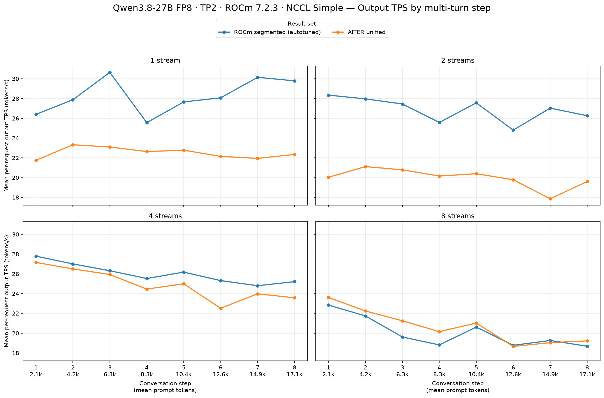
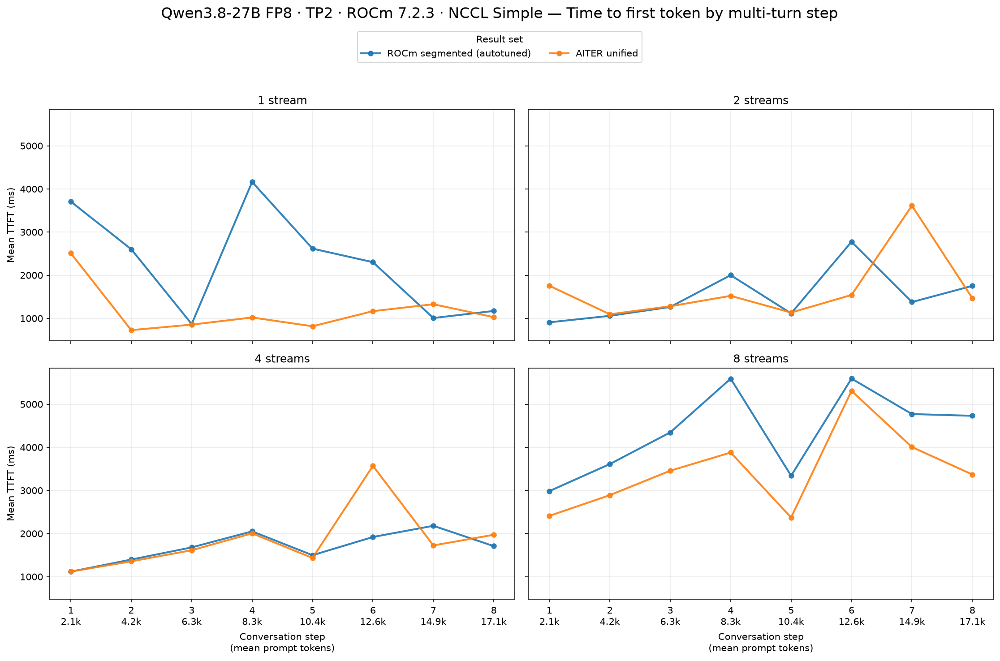
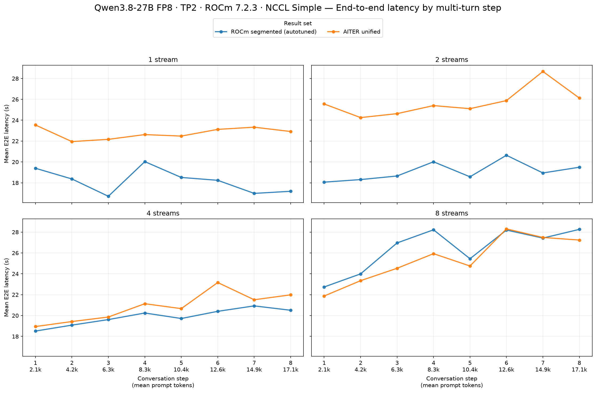

# TP2 ROCm 7.2.3: autotuned segmented attention vs AITER unified attention

Autotuned segmented attention delivered higher mean per-request output TPS and lower end-to-end latency at 1, 2, and 4 configured streams. At 8 streams, unified attention delivered 3.0% higher TPS, 20.8% lower TTFT, and 3.7% lower end-to-end latency. Unified also had lower TTFT at 1 stream, despite slower generation overall.

## Setup and compatibility

Both fresh runs used this container's ROCm 7.2.3 installation, two gfx1201 GPUs, Qwen/Qwen3.8-27B-FP8, TP2, BF16 activations, FP8 KV cache, prefix caching, `NCCL_PROTO=Simple`, and `VLLM_ROCM_USE_AITER=1`. Both used max_num_seqs=8, max_num_batched_tokens=8192, gpu_memory_utilization=0.92, max_model_len=auto (262144), and fastsafetensors loading. Debug logging was disabled.

The baseline explicitly selected `ROCM_SEGMENTED_ATTN`, set `VLLM_ROCM_USE_AITER_UNIFIED_ATTENTION=0`, and enabled `--kernel-config '{"enable_rocm_segmented_attn_autotune": true}'`. The candidate selected `ROCM_AITER_UNIFIED_ATTN` and set `VLLM_ROCM_USE_AITER_UNIFIED_ATTENTION=1`. Other AITER operation switches used the same defaults.

- vLLM commit: `2342343746093e5cd33799cd60186d10c4addea9`.
- AITER commit: `e4ceb9dd95e12595dc9d87a06eaef79dfd6cdb8c` (editable installation).
- GuideLLM: 0.7.3, from the repository's locked benchmark environment.
- Config: [simple-agent-multiturn-prefix-cache.json](../../../../benchmarks-configs/simple-agent-multiturn-prefix-cache.json).
- Identical workload-defining fields were checked: streams 1/2/4/8, 8 turns, prompt_tokens=2048, output_tokens=512, seed=20260715, warmup=1 request, and request limits 8/16/32/64.
- Both reports contain 120 successful turn requests, zero errored requests, and zero incomplete requests. Every successful request produced exactly 512 output tokens; each stream level contains all eight turn indices.

The older ROCm10 result was not used in this comparison. These are end-to-end serving results on the same software stack, not isolated attention microbenchmarks. Backend-specific cache layout, block size, tuning, and scheduling are included in the measured configurations.

## Results

Baseline → candidate means **autotuned segmented → AITER unified**. Means use every `requests.successful` record, including warmup/cooldown records, for both this table and the figures. They are not taken from GuideLLM's filtered metric summaries. TPS is mean per-request output throughput, not aggregate server throughput. Positive TPS changes improve performance; negative TTFT/E2E changes improve performance. Improvements are bold.

| Streams | Output tok/s, baseline → candidate | Output tok/s change | Mean TTFT (ms), baseline → candidate | Mean TTFT (ms) change | Mean E2E (s), baseline → candidate | Mean E2E (s) change |
|---:|---:|---:|---:|---:|---:|---:|
| 1 | 28.27 → 22.50 | −20.4% | 2,304 → 1,181 | **−48.8%** | 18.18 → 22.77 | +25.2% |
| 2 | 26.88 → 19.97 | −25.7% | 1,531 → 1,676 | +9.4% | 19.09 → 25.70 | +34.7% |
| 4 | 26.02 → 24.89 | −4.3% | 1,694 → 1,849 | +9.2% | 19.88 → 20.84 | +4.8% |
| 8 | 20.04 → 20.65 | **+3.0%** | 4,371 → 3,462 | **−20.8%** | 26.41 → 25.43 | **−3.7%** |

## Per-turn figures

The TPS chart shows segmented ahead at every turn for 1, 2, and 4 streams. At 8 streams unified is ahead for most early turns; the later-turn rates are close. Unified's 8-stream TTFT is lower at every turn, whereas the 2- and 4-stream TTFT curves include spikes that affect their means. At 1 stream, unified's faster first-token response does not offset its slower generation of 512 tokens.

For this run, segmented is the stronger choice for low-concurrency generation speed. Unified is competitive at higher concurrency and has the better 8-stream first-token latency. The small 8-stream TPS/E2E differences need repeated runs before treating them as a stable advantage.

## Achieved concurrency and request counts

The achieved concurrency values below are the reports' `metrics.request_concurrency.successful.mean`, shown as a diagnostic only; they were not substituted into the request-level performance table. Conversation completion and the one-request warmup mean the configured stream count is not sustained throughout a phase.

| Configured streams | Segmented achieved mean | Unified achieved mean | Successful requests, segmented / unified |
| ---: | ---: | ---: | ---: |
| 1 | 1.000 | 1.000 | 8 / 8 |
| 2 | 1.999 | 1.999 | 16 / 16 |
| 4 | 2.106 | 2.108 | 32 / 32 |
| 8 | 4.734 | 4.315 | 64 / 64 |

At 8 streams, segmented achieved a higher mean concurrency (4.734 vs 4.315), so the small per-request TPS difference is not a strict equal-load kernel comparison. At 1/2/4 streams achieved means are very similar. Generated responses differ between runs, and therefore accumulated prompt lengths differ slightly despite identical synthetic workload settings; contexts grow from about 2.1k tokens to roughly 17k tokens.

## Startup and measurement caveats

The initial segmented tuning pass took 1005.74 seconds and tuned 221 shapes. It skipped 26 extreme-context shapes for VRAM limits, including 131072/262144-token contexts with larger batches. Those contexts exceed this benchmark's approximately 17k-token contexts; successful measured requests were unaffected. Subsequent layers loaded the 221-entry persistent tuning table and retried missing shapes. A snapshot is saved with the segmented result.

Engine initialization took 1354.95 seconds for segmented versus 227.45 seconds for unified. These are recorded startup observations, include different cache/tuning preparation, and are separate from the serving metrics above. Persistent tuning should reduce subsequent startup cost, though skipped shapes may be retried.

Both servers logged some inference-time JIT compilation while the first benchmark shapes were exercised. The one-request warmup does not establish that every turn/shape was warm. TTFT includes those effects; this is one fresh run per configuration, without confidence intervals or an output-quality evaluation. No request failures occurred in either run.

## Saved inputs

- [Segmented result JSON](../../../../results/gfx1201/qwen3.8-27b-fp8/tp2-rocm723-segmented-attn-autotune-fp8-nccl-simple/agent-multiturn-benchmarks.json), [server log](../../../../results/gfx1201/qwen3.8-27b-fp8/tp2-rocm723-segmented-attn-autotune-fp8-nccl-simple/server.log), [launch script](../../../../results/gfx1201/qwen3.8-27b-fp8/tp2-rocm723-segmented-attn-autotune-fp8-nccl-simple/server-start.bash), and [tuning snapshot](../../../../results/gfx1201/qwen3.8-27b-fp8/tp2-rocm723-segmented-attn-autotune-fp8-nccl-simple/segmented-autotune-cache.json).
- [Unified result JSON](../../../../results/gfx1201/qwen3.8-27b-fp8/tp2-aiter-unified-attn-fp8-nccl-simple/agent-multiturn-benchmarks.json), [server log](../../../../results/gfx1201/qwen3.8-27b-fp8/tp2-aiter-unified-attn-fp8-nccl-simple/server.log), and [launch script](../../../../results/gfx1201/qwen3.8-27b-fp8/tp2-aiter-unified-attn-fp8-nccl-simple/server-start.bash).

Generated with the repository's [GuideLLM comparison skill](../../../../guidellm-benchmark-compare/SKILL.md), using its bundled plot and summary helpers. TPS and TTFT figures were visually inspected.
