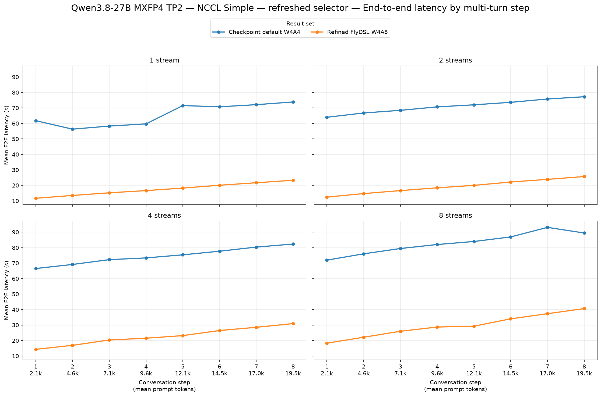
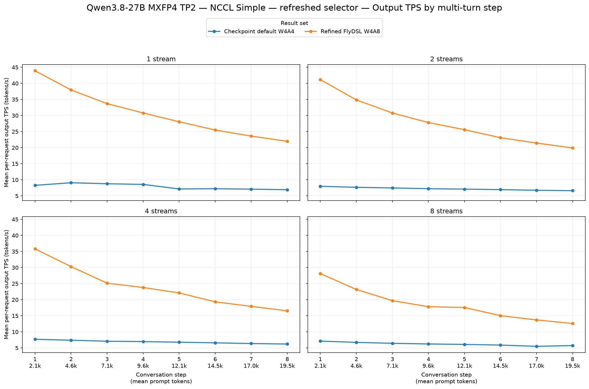
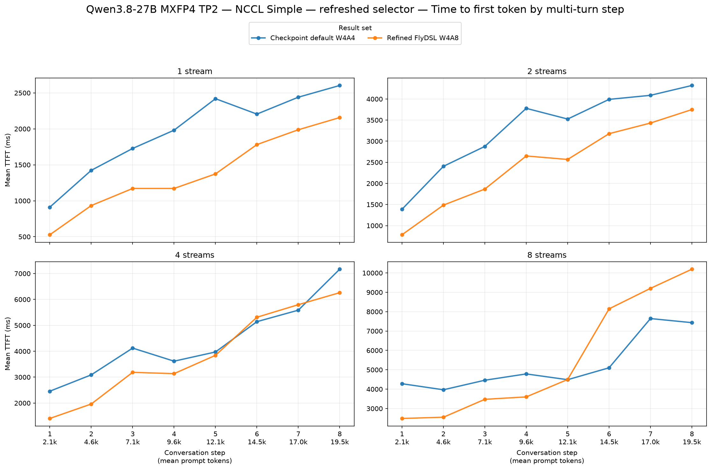

# TP2 default versus refined FlyDSL MXFP4 — NCCL Simple

Fresh measurements of `amd/Qwen3.8-27B-Quark-AWQ-MXFP4` revision `5233554c5fa56afda40150556b95573c2d7d29c0` on two R9700 gfx1201 GPUs. Both cases use TP2, graphs enabled, default attention, and NCCL_PROTO=Simple (confirmed in both ranks). Segmented attention and speculative decoding are disabled.

The model, tokenizer, configured workload, stream levels 1/2/4/8, eight turns, 2,048 new prompt tokens per turn, 512 output tokens and seed match. Both cases retain two full passes; pass 2 was selected before measurement and prefixes reset before each pass. Every pass saves 120/120 successful request records with zero errors or incomplete records.

Means include every saved successful request, including first turns. Output TPS is per-request output TPS, not aggregate throughput. Positive TPS changes and negative TTFT/E2E changes improve performance. These are end-to-end serving point estimates without run-to-run confidence intervals.

| Streams | Output tok/s, baseline → candidate | Output tok/s change | Mean TTFT (ms), baseline → candidate | Mean TTFT (ms) change | Mean E2E (s), baseline → candidate | Mean E2E (s) change |
|---:|---:|---:|---:|---:|---:|---:|
| 1 | 7.90 → 30.69 | **+288.7%** | 1,964 → 1,388 | **−29.3%** | 65.54 → 17.53 | **−73.2%** |
| 2 | 7.23 → 28.09 | **+288.5%** | 3,297 → 2,464 | **−25.3%** | 71.07 → 19.24 | **−72.9%** |
| 4 | 6.89 → 23.88 | **+246.4%** | 4,394 → 3,863 | **−12.1%** | 74.62 → 22.78 | **−69.5%** |
| 8 | 6.22 → 18.48 | **+196.9%** | 5,271 → 5,520 | +4.7% | 82.85 → 29.55 | **−64.3%** |

FlyDSL delivers 2.97–3.89× per-request output TPS and reduces mean E2E latency by 64.3–73.2%. Mean TTFT improves at 1, 2 and 4 streams. At 8 streams, mean TTFT is 4.7% higher (249 ms), with the per-turn plot showing the regression in the later conversation turns. This run does not isolate the cause of that TTFT regression.

The default uses checkpoint A4 activations and per-invocation emulation. FlyDSL uses per-token FP8 activations with compressed MXFP4 weights. This includes the activation-precision change and does not isolate a precision-matched kernel improvement. Both cases use the same vLLM branch containing the optional backend; the baseline exercises checkpoint-default dispatch. Generated histories can differ, and observed prompt-length means are retained in summary.json.

Graph capture completed in both cases with FULL_AND_PIECEWISE mode. The selected native pass 2 recorded zero executable creation/load events during the measured workload. Native pass 1 recorded 62 such host intervals, at most 25.4 ms each; neither native pass had an interval of 50 ms or more. No native inference-JIT warnings or preemptions were observed in the saved workload segments.

Native executable intervals include host cache loading and synchronization; ≥50 ms intervals are not proof of GPU compilation. Their counts, native inference JIT warnings, prefix resets, preemptions and both complete passes are retained in the audit.

Generated with the vllm-bench-collection GuideLLM comparison skill. The plot and table helpers consume the same successful-request records. TPS and TTFT plots were visually inspected; image paths and the saved successful-request means were checked.

Refreshed 2026-11-05 UTC. This directory keeps its previous name for existing links; the measurements above replace the older comparison.

Raw inputs: [default pass 2](../../../../results/gfx1201/qwen3.8-27b-mxfp4/tp2-simple-20261105/default/pass2/agent-multiturn-benchmarks.json) and [FlyDSL pass 2](../../../../results/gfx1201/qwen3.8-27b-mxfp4/tp2-simple-20261105/flydsl/pass2/agent-multiturn-benchmarks.json). Both complete passes, setup and runtime versions are retained beside those reports.

[Comparison skill](../../../../guidellm-benchmark-compare/SKILL.md) · [FlyDSL draft PR](https://github.com/ROCm/FlyDSL/pull/1374).
